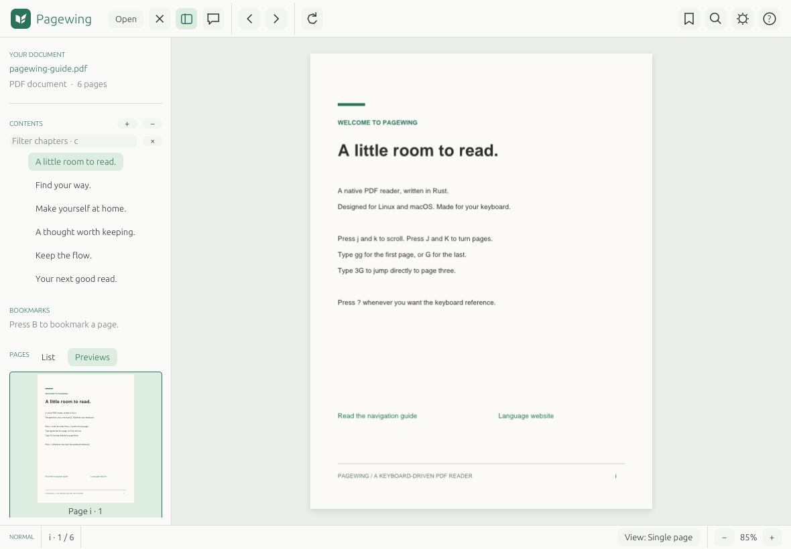

# Pagewing

用 Rust 编写的原生 PDF 阅读器，支持 Linux（Wayland / X11）和 macOS。使用 eframe / egui 构建界面，hayro 在后台进行纯 Rust PDF 渲染，无需安装 PDFium 或 Poppler。



## 运行

需要 Rust **1.92 或更新版本**。

```sh
cargo run --release -- assets/pagewing-guide.pdf
# 打开空白阅读器，然后选择或拖入自己的文档
cargo run --release
# 安装命令行程序
cargo install --path . --locked
pagewing /path/to/book.pdf
# 从指定的物理页开始阅读
pagewing --page 12 /path/to/book.pdf
# 文件名以 - 开头时，用 -- 结束选项解析
pagewing -- '-notes.pdf'
pagewing --version
# 在终端查看页数、格式、大小及文档元数据
pagewing --info /path/to/book.pdf
```

Linux 需要正常工作的桌面会话、OpenGL、X11 或 Wayland 及 libxkbcommon。Ubuntu / Debian 可安装：

```sh
sudo apt install build-essential pkg-config libxkbcommon-dev libxkbcommon-x11-0 libwayland-dev libgl1-mesa-dev libx11-dev libxi-dev libxrandr-dev
```

NixOS / Nix 用户可以在 `nix-shell` 中构建和运行。Linux 文件选择器使用 XDG Desktop Portal，需要桌面环境对应的 portal 服务。macOS 使用系统文件选择器；运行 `bash scripts/bundle-macos.sh` 可把 release 构建打包为 `target/Pagewing.app`。将应用复制到 `/Applications` 后，可在 Finder 中通过 PDF 的“打开方式”选择 Pagewing，应用启动前后均支持。一次选择多个 PDF 时，额外文件会在独立窗口中打开；当前窗口有未保存的 comment 时会提示先保存或放弃。

Linux 可安装为当前用户的桌面应用，随后从应用菜单或 PDF 的“打开方式”选择 Pagewing：

```sh
cargo build --release --locked
bash scripts/install-linux.sh
# 自定义程序安装目录
bash scripts/install-linux.sh --prefix /path/to/pagewing
# 卸载默认安装，保留阅读进度
bash scripts/install-linux.sh --uninstall
# 自定义安装使用相同的 prefix 和 XDG_DATA_HOME 卸载
bash scripts/install-linux.sh --prefix /path/to/pagewing --uninstall
```

默认二进制安装到 `~/.local/bin/pagewing`；桌面文件和图标使用 `$XDG_DATA_HOME`，未设置时使用 `PREFIX/share`（默认 `~/.local/share`）。桌面入口使用完整路径，支持安装目录中的空格、中文及特殊字符。再次运行脚本会原子替换二进制，已有窗口可以继续阅读；终端中使用 `pagewing` 时需将安装目录的 `bin` 加入 `PATH`。安装脚本不改变默认 PDF 应用。

中文文件名、目录和搜索框会自动使用系统中文字体。Linux 可安装 `fonts-noto-cjk`；macOS 使用系统字体。也可以设置 `PAGEWING_FONT=/path/to/font.otf` 指定回退字体，字体在后台加载。

命令行一次打开一份文档。文本导出和图像导出的页码从 1 开始，图像宽度为 1–16384 像素，基准轮数为 1–1000；缺少参数、数值越界或参数过多时，会在读取 PDF 前报告错误。Linux 和 macOS 的非 UTF-8 文件路径按原始路径保留。

PNG 导出在读取和渲染前检查输出是否指向源 PDF；同路径、相对路径别名、符号链接和硬链接会被拒绝，保留原 PDF。请为图像选择单独的输出文件。

命令行文本、帮助和测量结果可接入管道；下游提前关闭时正常退出，不打印 Broken pipe 崩溃。其他标准输出写入错误仍会报告并返回失败。

`pagewing --info document.pdf` 输出文件路径、PDF 版本、字节数、页数及可用的标题、作者等元数据，无需图形会话或页面渲染，不写入阅读状态。空元数据字段省略；超长字段按文档信息窗口相同的规则截断。需要密码的 PDF 会报告加载错误。

非 UTF-8 路径同样支持最近文档、阅读进度、书签和命名位置的保存与恢复；界面显示的替代字符不会改变实际文件路径。

`pagewing --page 12 [--] document.pdf` 从第 12 个物理页打开，页码从 1 开始，超过文档页数时打开末页。指定页会覆盖上次页码和页内滚动，保留已保存的缩放、旋转、书签与命名位置；加密文档在解锁后定位。普通启动继续恢复上次阅读位置。

文档被编辑器或编译工具更新后，会在文件变化稳定约一秒后自动刷新，保留当前页码、缩放、旋转和阅读位置，不切换窗口焦点。批注编辑或保存、文本选择及鼠标操作期间暂缓刷新，结束操作后再加载；隐藏批注面板仍会保留草稿并暂缓刷新。文件尚未写完或暂时被移走时，加载失败仍可继续阅读旧内容，下一次文件变化后会自动重试。需要重新输入密码时保留旧内容，按 `Ctrl/Cmd+r` 手动解锁新版 PDF。页面顶部的 Reload / Dismiss 可立即重试或忽略当前变化，后续更新仍会检测。

## SyncTeX 双向搜索

需要安装 TeX Live / MacTeX，并用 `-synctex=1` 编译，生成 PDF 及对应的 `.synctex.gz`（也支持未压缩的 `.synctex`）。Pagewing 调用 `synctex` 查询；可用 `PAGEWING_SYNCTEX=/path/to/synctex` 指定程序。

```sh
# 正向搜索：源码第 42 行、第 1 列 → PDF，列不确定时传 0
pagewing --forward-search 42 1 /path/to/main.tex /path/to/build/main.pdf
# 配置反向搜索：在页面上 Ctrl+单击（macOS：Cmd+单击）跳回编辑器
pagewing --inverse-search 'code --goto "%f:%l:%c"' /path/to/build/main.pdf
# 可与正向搜索一起传入
pagewing --inverse-search 'nvim --server /tmp/nvim.sock --remote-silent +%l %f' \
  --forward-search 42 1 /path/to/main.tex /path/to/build/main.pdf
# SyncTeX 文件与 PDF 不在同一目录时
pagewing --synctex-directory /path/to/aux \
  --forward-search 42 1 /path/to/main.tex /path/to/build/main.pdf
```

正向搜索会复用同一 PDF 已打开的 Pagewing 窗口，重新加载编译结果、定位并短暂高亮目标；没有窗口时打开新窗口。反向搜索支持单页、连续滚动、缩放和旋转，选择模式中先按 `Escape` 退出。未保存的 comment 会阻止正向搜索重载，请先保存或放弃草稿。

编辑器命令中的 `%f`、`%l`、`%c` 分别是完整源码路径、从 1 开始的行列，`%%` 表示百分号；SyncTeX 未提供列时使用 1。命令按引号拆分后直接启动程序，路径中的空格和特殊字符会作为参数保留，不执行 shell 管道或重定向。编辑器程序需在 `PATH` 中或使用完整路径。`--inverse-search` 的配置在当前窗口中保留；也可设置环境变量 `PAGEWING_EDITOR='code --goto "%f:%l:%c"'` 为默认命令。编辑器复用同一窗口时，省略 `--inverse-search` 会保留该窗口已有配置。文件名以 `-` 开头时，在 PDF 路径前加 `--`。

### TeXquill / Neovim 接入

使用支持 Pagewing 的 tex-tools.nvim，选择 `lsp = 'texquill'` 和 `viewer.method = 'pagewing'`，并将 `viewer.executable` 指向 Pagewing 二进制。`TexToolsForwardSearch` 会调用当前 TeXquill 会话，将结果直接交给 Pagewing；Cmd/Ctrl+单击由同一 Neovim 会话调用 `latex.inverseSearch` 后跳转。`TexToolsView` 同样自动配置回调，`viewer.focus = false` 保持编辑器焦点。需先保存并成功编译；LSP 继续负责根文件、产物目录和过期检查。

```lua
require('tex-tools').setup({
  lsp = 'texquill',
  viewer = {
    method = 'pagewing',
    executable = '/path/to/pagewing',
    focus = false,
  },
})
```

阅读器集成接口：`--synctex-location JSON` 接收 `{page,x,y,h?,v?,width?,height?}`（与 TeXquill 相同：页码从 1 开始，未旋转页面左上角为原点，单位为 1/72 英寸；高亮框四个字段需一起提供）。`--inverse-search-position COMMAND` 将 PDF 路径 `%f`、页码 `%p`、坐标 `%x`/`%y` 交给客户端处理，不运行本地 SyncTeX；它与源码回调 `--inverse-search` 互斥。两种回调均先拆分引号再替换占位符，`%%` 表示百分号。`--no-focus` 让打开或复用窗口时不请求焦点；实际表现受窗口系统控制。重启 Neovim 或其 LSP 后，再从编辑器执行一次 View/ForwardSearch，重新关联 PDF 会话。回调仅导航到请求对应的 PDF/项目，旧请求结果会被忽略。

## 高亮与 comment

按 `v` 进入选择模式并拖选文字，点击工具栏 **Add comment**（或 `Ctrl/Cmd+Shift+h`），在右侧 Comments 面板输入批注后点击 **Save comment**（或 `Ctrl/Cmd+Enter`）。保存直接更新当前 PDF 文件，并保留阅读位置；无需选择保存路径，不生成副本或备份。每次保存一条新增或修改的批注，可继续添加下一条。快速输入后立即按保存快捷键也会保留末尾文字；同一批操作中的隐藏面板与翻页不会丢弃已请求的保存。保存完成前会阻止关闭、重载或恢复其他文档，完成后可重试。comment 可以包含中文和多行文字，也可以留空以只保存高亮。

打开 PDF 后，**Comments** 侧栏默认关闭。点击工具栏 **Comments**（或 `Ctrl/Cmd+Shift+m`）可显示或隐藏面板。右侧列表按文档页序展示批注线程，回复缩进排列在父批注下，以固定高度卡片显示页码、作者、状态与正文摘要；悬停或打开编辑器可查看全文。列表只绘制可见条目，面板宽度可拖动调整。编辑器的保存和放弃按钮固定在面板底部，长批注与小窗口也能直接操作；底部显示已保存或未保存状态。紧凑窗口使用 **Save / Discard**，回复和删除收进 **More…** 菜单。点击条目会跳到对应页面，并可编辑 comment；普通阅读模式下，悬停高亮可预览 comment，点击高亮可打开编辑器。单页和连续滚动模式均支持；读取 PDF 的 `Contents` 文本，不包含云端讨论或独立的 Skim notes 文件。

批注筛选：面板顶部可按正文与作者搜索，支持 Unicode 大小写折叠和空格分隔的多个关键词；各词可分别匹配作者或正文。可叠加 **All statuses** 状态选择、**Marked only** 勾选标记及 **Current page** 当前页筛选。

命中回复时保留它的父批注作为上下文，并区分实际命中数与展示条数。在筛选框中用 `↑` / `↓` 或 `Ctrl+j/k` 选择条目，按 `Enter` 打开；更改筛选后默认选中首个实际命中，列表自动滚动到选中条目。键盘移动只滚动必要距离；调整窗口或面板大小、打开编辑器后会重新显示当前条目，正常手动滚动仍会保留。键盘也可选择保留的父批注；空结果不会跳转，未保存草稿继续受到保护。

**Clear filters** 清除全部条件。筛选不会改变 PDF 上的批注显示或丢弃编辑草稿；保存批注及重载当前文档后保留条件，切换文档时重置。小窗口中整个面板也可滚动。通过快捷键、工具栏或面板的关闭按钮隐藏批注时会立即释放输入焦点，随后输入的阅读快捷键可直接使用；筛选和草稿继续保留。

嵌套回复：选中已保存的批注，点击 **Reply**，输入回复后使用 **Save comment**（或 `Ctrl/Cmd+Enter`）保存。回复也可以继续回复，支持多层嵌套；深层回复的缩进会限制宽度，保留可读空间。回复以标准 PDF Text 批注及 `IRT` / `RT=R` 关系保存在原文件中，不会再创建文字高亮。已有 Acrobat 回复会自动组成线程。

批注状态：编辑器提供 **Status** 选择器，支持 **None**（无状态）、**Accepted**（已接受）、**Rejected**（已拒绝）、**Cancelled**（已取消）、**Completed / resolved**（已完成／已解决），以及独立的 **Marked (Acrobat checkmark)** 勾选标记。点击 **Save comment** 后写入 PDF；只改状态也会作为未保存草稿保护。状态使用 Acrobat 的标准 `StateModel=Review` / `Marked` 与 `State` 文本字段，保存为独立的状态回复，侧栏不会把它们显示成空白 comment。**Status history** 可查看各作者的状态记录；Pagewing 添加自己的状态，保留其他审阅者的历史。界面优先显示 Pagewing 的状态，否则显示读取到的外部状态。这里“已解决”对应本地 PDF 的 **Completed**，不连接 Acrobat 云端审阅的 Resolve 操作。

删除批注：在右侧列表中选中已保存的条目，点击 **Delete comment & highlight**。程序会直接更新当前 PDF，删除整条批注及其高亮、关联弹窗、多层回复和状态历史，列表自动刷新，也会清理其他页面上引用该批注的回复。选中回复时显示 **Delete reply & replies**，只删除这条回复及其子回复，保留父批注和其他分支。FreeText 和超长批注也可整条删除，锁定批注不能删除。若只想删除 comment 文字并保留高亮，清空编辑框后点击 **Save comment**。尚未保存的新批注使用 **Discard / close editor** 放弃。

隐藏 Comments 面板会保留草稿；**Discard / close editor** 放弃本条修改。存在未保存草稿时，切换、关闭、重新加载文档或退出会提示先保存或放弃，避免丢失输入。保存采用 PDF 标准 Highlight/Contents 字段和高亮外观流，其他 PDF 阅读器也可显示；编辑现有 comment 时保留其他批注及页面内容。保存会先完成临时文件写入，再替换当前 PDF；若磁盘文件已被其他程序修改，会报告错误并保留 comment 草稿，避免覆盖外部更改。加密 PDF 暂不支持保存批注；锁定批注不能修改，超长批注及 FreeText 的文字只读，但可添加回复及状态而不改动原文。批注扫描最多检查 100,000 个条目并展示 10,000 条，超出时显示提示。

## 配置文件

设置通过 TOML 文件管理，程序内不再提供 Settings 界面。Linux 和 macOS 均读取 `~/.config/pagewing/config.toml`；若设置了绝对路径的 `XDG_CONFIG_HOME`，则读取 `$XDG_CONFIG_HOME/pagewing/config.toml`。首次打开阅读器时会从已有设置生成配置文件，保留原来的外观、默认视图和快捷键。文件存在后只读取，不会被阅读进度保存覆盖；修改后重启阅读器生效。

```toml
#:schema ./config.schema.json

[appearance]
dark = false
night = false
sidebar = false
thumbnails = false

[display]
layout = "single" # single / continuous / facing
fit = "page"      # page / width / height，也可写 1.5 表示 150%（0.05–8.0）
remember_documents = true

[shortcuts]
next_page = ["X", "Shift+J"] # 替换该动作的全部默认绑定
night = []                 # 停用该动作的快捷键
```

省略的字段使用内置默认值；省略的快捷键动作继承默认绑定。删除动作的配置行即可恢复其默认快捷键。完整示例见 [config.example.toml](assets/config.example.toml)，动作名与按键格式见[配置参考](docs/configuration.md)。

程序会在配置目录生成并更新 `config.schema.json`。新配置已包含上面的 `#:schema` 注释；已有配置在顶部补上这一行，即可在启用 Taplo 的 Neovim 或 VS Code Even Better TOML 中获得字段、可选值和快捷键动作的补全、悬浮说明及格式校验，支持离线使用。详见[编辑器补全](docs/configuration.md#编辑器补全与校验)。

默认视图用于首次打开的文档；`remember_documents = true` 时，已有文档仍恢复上次的位置和视图。设为 `false` 后，每次从第一页按默认视图打开，书签和命名位置保留；`--page` 仍可指定起始页。外观选项是启动时的默认值，阅读过程中仍可用工具栏或快捷键临时切换；下次启动重新应用配置文件。

配置格式、字段、按键或绑定冲突有误时，阅读器显示包含配置路径的错误，并使用内置默认设置，不覆盖原文件。文本编辑快捷键、数字计数及 `gg`、`z…`、`m…`、`'…` 等 Vim 组合命令保留。自定义阅读快捷键在输入框中不会触发阅读操作；帮助窗口和按钮提示会显示配置的按键。下表列出默认绑定。

底部错误栏的长消息可滚动，Copy error 可复制完整诊断，Dismiss 关闭提示。页面渲染失败可重画页面，文档读取失败可重开或重载；重载按钮提示显示实际配置的快捷键。窄窗口将按钮简写为 Retry / Copy，操作含义保留在悬停提示中。

## 键盘操作

窗口最小尺寸为 240 × 240 像素，支持同时缩窄宽度和高度。顶部工具栏和搜索栏在按钮放不下时可横向滚动：将指针移到栏内使用鼠标滚轮、触控板左右滑动，或拖动栏底部的横向滚动条。底部缩放与 View 显示模式菜单在窄窗口中也可横向滚动访问；侧栏内容可纵向滚动。

矮窗口会收起侧栏顶部的文件摘要，优先显示目录筛选和章节列表。按 `c` 聚焦目录后，键盘选中项会保持可见；调整窗口尺寸后仍能继续选择和回车跳转，支持 240 × 240 的最小窗口。

当前页码与总页数显示在底栏，点击可打开页码跳转对话框。页面导航快捷键只在阅读模式生效，输入搜索词或页码时不会触发页面导航。按 `?` 查看内置帮助。

搜索框与搜索按钮之间可用 Tab / Shift+Tab 移动焦点，Enter 或 Space 激活按钮。横向控件栏会在焦点变化或窗口变窄时显露当前控件；手动滚动后保留滚动位置。切换 Aa / Word 后焦点回到搜索框，可继续输入查询；按钮上的空格不会滚动页面或写进搜索词。

侧栏搜索结果会在摘要中标出当前命中的原文，支持 Unicode 大小写折叠，例如 `STRASSE` 对应 `Straße`。结果行保留少量前文，让命中词靠近行首；悬停可查看较完整的上下文。浅色与深色界面均提供高亮，点击结果跳转到对应页面。

**Results** 会打开侧栏并显露当前匹配项；尚未选择匹配项时显示首条结果，保留阅读页码。`n` / `N` 会同步显露结果区，相邻行已可见时只移动选择。窗口缩放或字体放大后，原本可见的当前结果会继续保持可见；手动滚离后保留滚动位置，再按 **Results** 可返回当前匹配项。

按 `Ctrl/Cmd+Alt+Z` 或点击底栏的缩放比例可直接输入百分比，例如 `125` 或 `125%`，按 Enter 或点击 Apply 应用；也可选择 50%、100%、150%、200% 预设。快捷键可通过配置中的 `zoom` 动作更改或停用。缩放保留视口中心，支持单页、连续和双页模式。超出页面允许范围的比例会限制到实际可用值；错误输入保留在框内，Escape 或 Cancel 放弃修改。

缩放窗口在 240 × 240 的最小阅读窗口中同时显示输入框、错误提示、全部预设及 Apply / Cancel，无需滚动。按 Tab 可依次选择预设与操作，Enter 执行；调整窗口尺寸保留正在编辑的比例。

帮助窗口支持按按键或功能说明筛选，例如 `zoom`、`copy link`；多个词需要同时匹配，英文不区分大小写。Copy shortcuts 可复制当前结果，清空筛选后可复制全部快捷键。窄窗口中快捷键和说明逐条排列，长列表可滚动；240 × 240 窗口中仍可筛选、复制和关闭。`Escape` 返回阅读，重新打开帮助会清空上次筛选。

文档信息窗口在窄窗口中按字段逐条排列，文件路径和长标题会换行，内容可滚动，Copy details 和 Close 按钮保持可见；按 `y` 仍可复制完整信息。文档信息与最近文档窗口都支持 240 × 240 的最小尺寸，放大窗口后恢复桌面布局。

页码跳转和密码输入窗口也支持最小尺寸。无效页码会在输入框下显示提示并保留文字；Go / Unlock 提交，Cancel、窗口关闭按钮或 Escape 取消。批注面板打开时，Escape 优先关闭当前输入窗口。密码默认隐藏，可勾选 Show password 检查输入；取消会丢弃这次输入，密码不写入阅读状态。

| 按键 | 操作 |
| --- | --- |
| `j` / `k` / `h` / `l` | 向下 / 上 / 左 / 右滚动；上下到达边缘后翻页 |
| `J` / `K`，`]` / `[` | 下一页 / 上一页 |
| `gg` / `G` | 首页 / 末页 |
| `42G`，`42 Enter`，`42gg` | 跳到第 42 页 |
| `Backspace` | 删除数字前缀末位，同时取消未完成的 `g` / `z` 命令；输入框内仍为删除文字 |
| `50%`，`25%`，`100%` | 按物理页数跳到文档的 50%、25% 或末页；`0%` 到首页 |
| `5j`，`2l`，`3J`，`3]`，`2 Space` | 带数字前缀的四向滚动、翻页和整屏滚动；数字与按键之间无需空格 |
| `Ctrl+d` / `Ctrl+u` | 下移 / 上移半屏 |
| `Ctrl+e` / `Ctrl+y`，`3 Ctrl+e` | 当前页内向下 / 向上滚动，到边缘停住；支持数字前缀 |
| `Space` / `Shift+Space` | 下移 / 上移一屏 |
| `zH` / `zL`，`2zL` | 向左 / 右滚动半屏，支持数字前缀；保留纵向位置，到边缘停住 |
| `z0` / `z$` | 当前页左端 / 右端，保留纵向位置、缩放和旋转 |
| `zt` / `zz` / `zb` | 当前页顶部 / 垂直中点 / 底部，保留缩放与横向位置 |
| 鼠标后退 / 前进侧键 | 恢复上一个 / 下一个阅读位置；文本输入和弹窗内不触发 |
| `Alt+Left` / `Alt+Right` | 历史返回 / 前进，恢复页码、缩放、旋转和滚动；支持数字前缀 |
| `+` / `-`，`Ctrl/Cmd` + `+` / `-` | 放大 / 缩小；`Ctrl/Cmd` + `=` 也可放大 |
| `3+` / `3-`，`4=` | 连续放大 / 缩小指定级数，保持视口中心；大计数直接到达缩放边界 |
| `Ctrl/Cmd+Alt+Z` | 输入精确缩放比例，Enter 应用，Escape 取消 |
| `a`，`Ctrl/Cmd+0` | 恢复 100% 缩放并保持视口中心；超大页面仍受尺寸上限约束 |
| `p` / `w` / `e` | 适合整页 / 适合宽度 / 适合高度 |
| `Shift+C` | 切换连续滚动 / 单页模式，也可通过底部 View 菜单选择 |
| `r` / `Shift+r`，`3r` / `3R` | 顺时针 / 逆时针旋转，支持数字前缀，回到页面起点 |
| `/`，`Ctrl/Cmd+f` | 全文搜索 |
| 搜索输入框中的 `Enter` / `Shift+Enter` | 下一个 / 上一个匹配；结果尚未就绪时等待扫描 |
| `Ctrl/Cmd+p` | 筛选最近文档；方向键或 `Ctrl+j/k` 选择，回车打开 |
| `s`，然后 `y` | 查看文档信息并复制路径、格式、大小、页数和元数据 |
| `c` | 筛选章节；方向键或 `Ctrl+j/k` 逐条选择，`PageUp/PageDown` 按视口移动，回车跳转 |
| `Alt+c` / `Alt+w` | 搜索栏打开时切换区分大小写 / 整词匹配 |
| `n` / `N`，`3n` / `3N` | 下一个 / 上一个搜索匹配，支持数字计数（`F3` / `Shift+F3` 同样生效） |
| `f`，然后输入标签 | 跟随当前可见的 PDF 链接；`Escape` 取消 |
| `F`，然后输入标签 | 复制当前可见的网页链接地址；仅给网页链接编号，`Escape` 取消 |
| `b` | 添加 / 删除当前页书签 |
| `Alt+j` / `Alt+k`，`3 Alt+j` | 下一个 / 上一个书签，支持数字前缀；到末尾后循环 |
| `ma`，`'a` 或 `` `a `` | 保存 / 返回命名位置，字母可用 `a`–`z`；同时恢复缩放、旋转和页内滚动 |
| `''` 或双反引号 | 返回上次跳转前的阅读位置；重复按可在两个完整视图间切换 |
| `Tab` | 打开 / 关闭侧栏 |
| `t` | 切换页码列表 / 缩略图，并打开侧栏 |
| `d` / `i` | 切换深色界面 / 反转页面颜色 |
| `y` | 复制当前页文本 |
| `Ctrl/Cmd+a`，然后 `y` 或 `Ctrl/Cmd+c` | 全选并复制当前页文字；搜索框等输入框内仍为全选输入文字 |
| `v`，拖选，`y` 或 `Ctrl/Cmd+C` | 选择并复制部分文本；`v` 或 `Escape` 退出选择模式 |
| 选择模式中双击 / 三击 | 选中整个词 / 整行；之后拖动按词 / 行扩展，单击恢复按字形选择 |
| `o`，`Ctrl/Cmd+o` | 打开文档 |
| `Ctrl/Cmd+r` | 重新加载当前 PDF，保留阅读位置和标记 |
| `Ctrl/Cmd+w` | 关闭当前文档，保存位置并返回欢迎页 |
| `Ctrl/Cmd+Shift+t` | 恢复本次会话中最近关闭的一份文档及其阅读位置 |
| `Ctrl/Cmd+q` | 正常退出并保存最新阅读状态 |
| `:` | 页码跳转对话框 |
| `:+5 Enter` / `:-5 Enter` | 从当前页前进 / 后退 5 个物理页，超过边界时停在首页或末页 |
| `:50% Enter` | 在页码对话框中跳到文档的 50%，也可点击底栏页码后输入 `50%` |
| `F11` | 全屏 |
| `Escape` | 关闭对话框或搜索，取消数字前缀 |

底部状态栏提供 **− / 缩放比例 / +**；点击 **View** 菜单可集中选择单页（Single page）、连续滚动（Continuous）、双页并排（Two pages side by side），以及适合整页、宽度、高度和实际大小。双页模式从第 1 页起按 1–2、3–4 配对，共用缩放比例；翻页切换整组，末尾落单页居中显示。显示模式会随文档、命名位置和历史记录保存与恢复。

在 **View** 菜单选择 **Continuous** 或按 `Shift+C` 开启连续滚动：页面按纵向排列，滚轮、触控板、拖动和 `j/k`、半屏 / 整屏滚动均可跨页，页码及侧栏随阅读位置更新。模式按文档保存，重新打开时恢复页码和滚动位置；旧阅读记录默认使用单页模式。连续模式仅渲染可见页面并预取相邻页，多个可见页共享 96 MiB 页面纹理缓存。搜索高亮、内部链接、缩放、旋转和单页文本选择同样可用；`f/F` 链接提示针对当前页，文本选择不跨页。`zt/zz/zb` 仍对齐当前页，`Ctrl+e/y` 在连续模式中也可跨页。

鼠标滚轮或触控板滚动，拖动平移，按 `p` 恢复适合整页。高倍缩放时按屏幕像素密度渲染可见区域的高清图块，平移后自动更新。键盘缩放保持视口中心；`Alt`（macOS 上为 Option）+滚轮或触控板捏合缩放保持指针下的位置。`v` 进入文本选择模式，拖选会高亮选区，支持反向、跨行和旋转后的文字；文本顺序取决于 PDF 的文本层。支持 PDF 文件拖入、加密文档密码输入、文档目录跳转、搜索结果高亮、书签、最近文档和阅读位置恢复。命名位置显示在侧栏，可点击返回或删除。重启后恢复页码与页内滚动，窗口尺寸变化时按相对滚动位置恢复。侧栏目录支持逐章节折叠、全部展开/折叠和 Unicode 标题筛选；筛选会显示命中条目的祖先，清空后恢复原来的折叠状态。目录支持 GoTo 动作和命名目标；内部链接和目录会应用 `XYZ` 的页内位置与缩放，以及 `Fit`、`FitH`、`FitV` 和 `FitR` 目标视图，支持裁剪框、文档自带旋转、阅读旋转及同页重新定位；网页链接在系统浏览器中打开；右键点击网页链接可复制地址，菜单内按回车复制、`Escape` 关闭，选择文字时保留文本操作。

目录筛选支持以空白分隔的多个关键词，顺序不限，所有关键词需出现在同一章节标题中；例如 `080 chapter` 可找到 `Chapter 080`。支持 Unicode 大小写折叠，如 `strasse` 匹配 `Straße`；保留匹配标题的祖先作为上下文，首次回车优先定位实际匹配标题，清空后恢复原来的折叠状态。

章节筛选框中的 `PageUp/PageDown` 按当前视口可容纳的完整行数移动选择，`Ctrl/Cmd+Home/End` 到首尾，只计入当前可见的章节和上下文标题。窗口大小与字体改变后使用新的行数；普通 `Home/End` 继续编辑文字。回车跟随目标；没有目标的标题可用回车展开或折叠。按 `Escape` 返回阅读。

单条目录标题最多保留 2048 个 Unicode 字符，超过时加省略号，跳转目标不受影响。筛选和悬停使用保留的标题前缀，避免超长标题反复占用解码、大小写折叠和排版资源。

支持 PDF 的文档页码标签，如前言 `i`、`ii` 和附录 `A-1`，同时显示对应的物理页码。按 `:` 后可以输入标签跳转；普通数字和 `42G` 始终表示物理页码，要跳到文档标签“1”可输入 `=1`。标签匹配支持 Unicode 大小写折叠，例如 `SS2` 可匹配 `ß2`；存在多个候选时精确标签优先，否则选择最早的匹配页。标签按区间保存，查找无需遍历整本文档。

在 `:` 对话框中输入 `+5` 或 `-5`，可从当前物理页前进或后退五页，超出文档范围时停在边缘。保留缩放和旋转，可用历史返回；`+0` / `-0` 保留当前页内滚动和前进历史。以正负号开头的数字标签可加 `=` 指定，例如 `=+21`、`=-21`；其他标签与普通页码继续按原规则处理。输入量使用非负整数，搜索框中的正负号仍作为文字输入。错误输入会保留内容并重新聚焦，便于直接修改。

命名目标的名称树中出现类型错误的键时，会忽略该键值对，继续识别同一节点后面的有效目标；不完整的末尾键和循环节点也不会影响已识别的跳转。

页面注释数组中的错误类型和失效引用会被跳过，后面的有效内部链接和网页链接仍可使用。每页最多检查 1000 个注释条目，无效条目也计入上限。

名称树和页码标签树同样会跳过错误子节点及失效引用，保留后续有效分支；名称树的待处理节点最多一万个，避免宽分支逐层累积占用内存。节点和深度限制之外的分支可能被忽略。

名称或页码标签的键值数组中，一对键值含有失效引用时会跳过整对，后面的条目仍按原来的键值位置读取。间接字符串键和间接目标继续支持，落单的末尾键被忽略；每个数组最多检查一万对，无效条目同样计入预算。

名称树和页码标签树各有独立的十万个原始数组条目扫描预算，覆盖整棵树的 Kids 和键值数组。键和值各算一项，无效类型、失效引用、重复键及落单末尾键也消耗额度，避免不同节点重复读取共享长数组。达到上限时保留已识别的名称与标签，后续分支可能被忽略；原有节点、深度和单数组限制继续生效。

百分比跳页按物理页数向上取整，例如 6 页文档的 `50%` 到第 3 页，`51%` 到第 4 页；超过 100% 到末页。跳转保留缩放和旋转，并可用历史返回；已经处于目标页时保留页内滚动。单独按 `%` 会提示先输入数字，搜索等输入框内的 `%` 仍作为文字输入。

页码对话框也支持百分比：按 `:` 或点击底栏页码，输入 `50%` 后确认。使用非负整数，可在数字和 `%` 之间留空格；`0%` 到首页，超过 100% 到末页。输入 `=50%` 可明确跳到同名 PDF 标签。未确认时继续作为输入文字编辑，输入无效时保留内容与焦点。

`''` 或连续两次反引号可返回上次跳转前的完整视图，再按一次切回来；支持同页搜索、链接和命名位置的跳转，以及历史返回/前进后的切换。此位置只在当前文档会话内保留，关闭文档后清空；重载删掉目标页时也会清除。输入框中这些按键继续输入普通文字。

横向图纸可按 `e` 适合高度，再用 `h/l` 横向阅读；旋转、窗口调整、标记、历史和重新打开都会保留自动适配模式。PDF 的 `FitV` / `FitBV` 目标同样使用该模式，窗口高度变化后继续适配。输入框内的字母 `e` 仍作为文字输入。

大幅面图纸也能适合整页：缩放下限会随页面尺寸降低，低于 5% 后仍可渐进缩放；极端页面会限制最大缩放，保持界面坐标可用。

普通阅读模式中的 `+`、`-` 和 `=` 支持数字前缀，例如 `3+` 相当于放大三级，`3-` 缩小三级。每级倍率为 1.2，直接计算最终缩放并保持视口中心；超大计数按当前页面的有效范围收敛，不逐级导航。前缀会在缩放后清除，后续 `J` 等按键仍按一次处理；输入框中的数字与正负号继续作为文字输入。

普通缩放按实际输入的符号识别，`_` 不会因与减号共用按键而缩小页面；它会取消未执行的数字计数。搜索等输入框中的下划线仍作为普通文字。

数字前缀输错时可按 `Backspace` 删除末位，例如 `42 Backspace G` 跳到第 4 页，`23 Backspace J` 前进两页。删除最后一位后恢复默认的一次操作；数字前缀仍最多七位，删除后可继续修改。未完成的 `g`、`z` 命令会同时取消，保留剩余数字；搜索、页码等输入框及链接标签中的退格继续按各自的编辑规则处理。

数字前缀按实际输入的 ASCII 数字识别，也支持需要按住 Shift 才输入数字的键盘布局。`@`、`#` 等标点不会因底层数字键码而混入计数；无对应阅读命令的标点会取消待执行的计数，搜索等输入框仍保留原样文字。

侧栏 `PAGES` 可切换 `List` 页码列表和 `Previews` 缩略图，也可按 `t` 切换并打开侧栏。两种模式都会跟随键盘跳页；手动滚动侧栏后再次按 `gg` / `G`，会重新显示目标页所在行。点击跳页时保留列表的滚动位置，便于连续点击相邻页。预览支持页面旋转和颜色反转，并记住所选模式。

切换页面列表或预览模式时，会显露当前页所在的页面区，长目录和书签不会遮住入口。缩略图会随侧栏宽度和窗口高度缩小，保留完整图像和页码，并按实际展示尺寸渲染。调整窗口大小时，正在查看的页面预览继续可见；手动滚到其他预览后，缩放窗口会保留附近的页面。

页面列表与预览文字优先显示物理页码，再显示 PDF 页码标签；长标签在行内或卡片内单行省略，标签中的换行会显示为空格。悬停列表行或预览可查看物理页码和完整的已读取标签。

书签列表同样优先显示物理页码，并提供完整标签的悬停提示。跳转目标已在列表视口内时保留相邻行的位置，越界时只滚动必要距离；手动滚动后，普通重绘保留所选位置，再次执行页码跳转可重新显露当前书签。

`v` 选择模式中双击按 Unicode 词边界选词，三击选中当前文本行；之后拖动会按相同单位扩展，单击恢复按字形选择。拖选时把指针停在阅读区域边缘会自动滚动，支持上下、左右与旋转页面；松开鼠标或到达页边后停止，不会自动翻页。双击选择时保留缩放；普通阅读模式下双击不改变缩放或阅读位置。组合重音和 emoji 不会在词选择中被拆开；中文按 Unicode 默认词边界处理，整行范围取决于 PDF 提取出的文本换行。

重新编译或更新 PDF 后，按 `Ctrl/Cmd+r` 可重新加载，保留页码、缩放、旋转、相对滚动位置和有效标记，并重新搜索当前查询。只有解析成功才切换文档；若文件暂时写入不完整，原文档仍可阅读，文件恢复后再次重新加载即可。

加密文档的密码框会自动聚焦，直接键入并按回车解锁。密码未被接受时，窗口内显示重试提示并重新聚焦输入框。按 `Escape` 取消后可用 `Ctrl/Cmd+R` 或错误栏的 Retry open / Retry reload 重新解锁；已打开的文档仍可阅读，重新解锁后保留当前位置。密码不写入阅读状态。不支持的加密算法和损坏的加密信息会显示对应错误。首次打开其他文件失败后，修复文件也可通过 Retry open 重试。

`Ctrl/Cmd+w` 或工具栏 Close 可在阅读、搜索、密码和打开失败的界面中关闭文档。关闭前立即提交阅读进度到后台状态写入器；界面返回欢迎页，页面和文本缓存释放，后台结束当前 PDF 会话。从最近文档重新打开会恢复位置、缩放、旋转、书签与标记。关闭空白欢迎页会保留窗口。

误关文档后按 `Ctrl/Cmd+Shift+t` 可直接恢复，不必先筛选最近列表。保留关闭前的页码、缩放、旋转、滚动、书签和命名位置；重复关闭空白欢迎页不会丢失待恢复文档。此入口只保存本次会话中最近关闭的一份文档路径，恢复一次后清除；没有待恢复文档时显示提示，当前输入和阅读位置保持。若批注尚未保存或正在保存，恢复目标会保留，完成保存或丢弃草稿后可重试。加密文档重新要求密码，失败或尚未加载完成的文档也可关闭后重试。重启后仍可使用最近文档列表。

`Ctrl/Cmd+p` 从最近 24 份文档中按文件名或完整路径筛选，支持 Unicode 大小写折叠与空格分隔的多个关键词。在筛选框中用方向键或 `Ctrl+j/k` 逐条选择，`PageUp/PageDown` 按当前视口的可见行数移动，`Ctrl/Cmd+Home/End` 到首尾；普通 `Home/End` 保留文字编辑功能。回车、双击或 Open 按钮打开并恢复该文档的阅读位置。调整窗口大小后，列表会重新显露选中项，保留筛选内容；平时可自由滚动列表。也可用 Tab 聚焦结果、Open 或 Cancel，按 Enter 激活当前控件。再次按快捷键、`Escape` 或 Cancel 关闭；筛选时输入不会触发页面导航。欢迎界面也提供入口。

欢迎页支持用 Tab / Shift+Tab 聚焦打开按钮、最近文档卡片和完整最近列表入口，按 Enter 或空格激活。焦点变化或调整窗口大小时会滚动显露当前控件，240×240 窗口也可操作；普通重绘会保留手动滚动的位置。

最近文档、章节和批注筛选框都保留 `Shift+↑/↓` 的文字选择功能；未加修饰键的 `↑/↓` 和 `Ctrl+j/k` 用于逐条移动结果。

## 性能设计

- PDF 加载、渲染、文本提取和搜索均放在后台线程，UI 通过事件唤醒。目录标题、文档信息和页码前缀按保留长度解码，避免为截掉的后缀创建临时字符串；UTF-16 直接读取字节，普通 ASCII 前缀直接复制，特殊 PDFDocEncoding 字节继续按编码表转换。
- 切换或关闭文档会取消过期加载；普通文件每读取 1 MiB、解析前后及整理元数据之间检查请求。Unix 命名管道等待发送方连接或暂停写入时也能取消，无需补足数据或等到 EOF。其他正在执行的系统调用或 PDF 引擎调用需要返回后才能检查，过期的完成或错误结果不会占用后台消息队列。
- 优先渲染当前页，再沿翻页方向优先预取相邻页；按各页尺寸、旋转和屏幕 DPI 计算分辨率，混合横竖版文档切页时可直接命中缓存。视图变化会替换尚未执行的渲染请求；已过期的在途结果会丢弃，仍需要的相同任务直接复用。
- GPU 页面纹理使用 **96 MiB LRU 缓存**，最多保留 512 项，预取不会淘汰当前页；高倍缩放时跳过无法与当前页同时放入缓存的预取任务，纹理上传前再次检查容量。文本索引使用 32 MiB LRU 缓存，最多保留 512 页，容量不足时只逐出最近最少使用的页面；大页或索引增长需要大量回收时，统一整理候选顺序，减少反复扫描，索引刷新回收其他页时保护当前页。
- 缩略图仅请求可见行，使用独立 **8 MiB LRU 缓存**，同样最多保留 512 项；滚动或关闭侧栏会取消过期任务，主页面渲染、文本操作和搜索优先执行。
- 复用文档的解释器和字形缓存；缩放时可先复用同页已有纹理。后台直接把 PDF 渲染到纹理像素缓冲区；0° / 180° 的反色与旋转原地完成，省去整页复制及第二块像素缓冲区；90° / 270° 直接生成旋转后的纹理，大页面使用分块访问。命令行图像导出继续在 0° 和 180° 复用原字节缓冲区。
- 搜索、整页复制与文本选择共享按需提取的文本缓存，选择模式通过共享引用接收当前页字形坐标，避免复制整页索引。
- 密集文本的拖选定位使用后台按需构建的纵向空间索引，先缩小候选范围，再按纵向、横向距离选择字形，保留短行、重叠字形及距离并列时的原有规则；索引容量计入文本缓存。整页全选先直接高亮全部文字，实际开始点击或拖选时才准备交互索引。
- 密集页的整词拖选与整词搜索共享 Unicode 边界位图，后台进入选择模式时预备，用位操作寻找相邻词边界，并按需缓存换行位置，避免反复从行首分词或扫描换行；可选文字达到 4096 字节时，即使字形很少也会准备文字边界，几何索引仍按字形数量决定。保留组合重音、emoji、撇号和 CRLF 的选择规则。
- ASCII 使用专门的折叠快速路径；Unicode 折叠保留源字符字节边界的页面也直接使用偏移。遇到大小写展开或字节长度改变时，仅为从该字符起的后缀建立源位置映射，中文等页面可省去整个数组。索引建成后按实际容量记账，初始预留过大而未缓存的页面会重新尝试进入缓存。
- 按物理像素渲染，宽度以 32 像素分档；单页限制为约 1600 万像素。
- 搜索输入延迟 180 ms 合并请求，复用 Unicode 完整大小写折叠索引，支持 `Straße` / `STRASSE`、`Σ` / `σ` / `ς` 和连字，以二分定位当前页匹配与文本坐标并合并相邻高亮；结果分页面返回，最多保留 10,000 个匹配。侧栏按可见行绘制全部结果，`n` / `N` 同步定位列表；旋转、放大后也会滚到匹配处。
- 搜索尚未返回时按 `Enter` 会保留跳转请求，等结果就绪后定位；关闭搜索或主动翻页会取消待处理的跳转。
- 选中单行文字后按 `/`、`Ctrl/Cmd+f` 或点击 Find，会将选中文字带入搜索并保留当前搜索选项。空选区或跨行选区保留原查询，避免将换行意外放进单行输入框。
- 搜索数字前缀直接计算目标匹配，无需逐条跳转；若结果仍在扫描且目标尚未就绪，会等待足够结果再定位，扫描完成后才循环到另一端。
- 搜索摘要直接截取匹配起点前 32、后 80 个 Unicode 字符，再统一替换换行，避免临时字符数组和多次字符串拼接。
- 密集页面每批最多返回 256 条匹配，批次间优先处理新的页面渲染、文本操作和搜索请求；不再单独截断每页的第 1,000 条以后结果，统一受全局 10,000 条上限约束。
- 搜索栏的 `Aa` 和 `Word` 可分别切换区分大小写、Unicode 整词匹配，两项可组合，设置在重启后保留。查询在后台首次扫描前仅预处理一次，页面渲染和文本操作优先执行；区分大小写直接搜索原文，整词边界按需建立为每字节一位的位图并计入文本缓存。首次使用默认忽略大小写的子串搜索。中文按 Unicode 词边界处理，不进行词典分词。
- 链接提示按字母前缀直接计算匹配索引范围，最多检查三个字符；只为匹配的提示生成标签。可见链接复用索引数组，重绘时不复制链接目标，悬停后才生成说明文字。
- 链接元数据使用 **4 MiB、最多 64 页的 LRU 缓存**，计入向量和 URL 容量，容量满时逐页淘汰；过期页面结果不会挤掉当前页。超大当前页的链接临时保留在缓存之外，离开该页即释放。
- 链接读取在首次解析内部跳转时才建立页面目标索引，随后在本次文档会话中复用；空页面和纯网页链接无需扫描所有页面来准备目标索引。
- 命名目标表在首次解析名称或字符串目标时才读取；普通直接页码和页面引用不读取整张名称表，目录和页面链接分别复用各自已准备的表。
- 渲染器移交像素缓冲区后，在后台转换为页面和缩略图所需的纹理像素；界面线程核对请求与缓存容量后上传。后台结果队列最多容纳 4 条消息，避免 UI 暂停时无限积累图像。
- 批注列表只绘制可见卡片，按需缓存最近遇到的最多 128 组卡片文字；命中时复用摘要、作者、页码标签和状态行，重新加载批注时释放旧缓存。
- 没有输入或后台结果时，界面不持续重绘。
- 阅读进度在独立后台线程序列化并原子替换阅读状态文件，队列只保留最新待写快照；写入失败后显示提示并重试，正常退出会等待最新状态写完。

阅读状态独立保存在 `library.json`，不作为手工配置入口。系统应用配置目录：Linux 为 `$XDG_CONFIG_HOME/pagewing/library.json`（默认 `~/.config/pagewing/library.json`），macOS 为 `~/Library/Application Support/dev.pagewing.Pagewing/library.json`。首次启动且新配置尚不存在时，会读取原 Folio 的阅读状态；后续保存写入 Pagewing 目录，原文件保留。密码不持久化。

## 验证与性能测量

```sh
cargo fmt --all --check
cargo clippy --locked --all-targets -- -D warnings
cargo test --locked
cargo run --release -- --render assets/pagewing-guide.pdf /tmp/page.png 1 1200
cargo run --release -- --text assets/pagewing-guide.pdf 1
cargo run --release -- --info assets/pagewing-guide.pdf
cargo run --release -- --benchmark assets/pagewing-guide.pdf 5
# 像素旋转专项基准，交替比较原实现与当前实现
cargo bench --locked --bench rotation -- 9
# 夜间反色与旋转：对比原两遍处理和合并处理
cargo bench --locked --bench rotation -- 9 night
# 纹理渲染：比较 RGBA 字节图像中转与直接写入纹理缓冲区，包含 PDF 光栅化
cargo bench --locked --bench texture_pixels -- 9
# 链接提示匹配基准，比较逐标签扫描与前缀范围计算
cargo bench --locked --bench link_hints -- 9
# 链接屏幕区域，比较逐帧重算与复用，并覆盖持续移动的视图
cargo bench --locked --bench link_visibility -- 9
# 密集页面拖选定位，分别记录查询、建索引耗时和索引容量
cargo bench --locked --bench selection -- 9
# 整词范围查询，比较重复分词与共享边界位图
cargo bench --locked --bench word_selection -- 9
# 字形很少但文本层很长的页面，测量词/行查询与后台准备
cargo bench --locked --bench sparse_selection -- 9
# 搜索索引构建，比较原映射与 ASCII 直接偏移的耗时及容量
cargo bench --locked --bench search_index -- 9
# 搜索摘要，比较临时字符串拼接与直接截取上下文
cargo bench --locked --bench search_snippet -- 9
# 搜索结果文字和高亮格式，比较重建、有界缓存、换行任务复制和分配次数
cargo bench --locked --bench search_result_text -- 9
# 预览文字：比较 Painter::text 复制字符串与直接移入有宽度限制的布局
cargo bench --locked --bench preview_caption -- 9
# 页码文字：比较完整标签生成后截取与按可见前缀生成摘要
cargo bench --locked --bench page_label_text -- 9
# 单页与双页状态栏文字构造（含显示名和分配，不含界面与渲染）
cargo bench --locked --bench status_text -- 21
# 快捷键帮助筛选：比较每次格式化与复用目录检索文字，含分配计数
cargo bench --locked --bench help_filter -- 21
# 完整分批文本搜索，包含匹配、高亮范围和摘要，复用已准备的文本与查询
cargo bench --locked --bench search_matching -- 9
# PDF 标题解码，比较 UTF-16 直接解码和 ASCII 复制路径
cargo bench --locked --bench pdf_strings -- 9
# 有界标题和元数据前缀，比较完整解码后截断与按需解码
cargo bench --locked --bench pdf_string_prefix -- 9
# 文件读取，比较普通读取与带取消检查的分块读取
cargo bench --locked --bench document_bytes -- 9
# 完整目录筛选，包含匹配、祖先保留、选择和可见行更新
cargo bench --locked --bench outline_filter -- 9
# 首次链接读取，包含目标索引初始化和无链接、网页、内部跳转三种页面
cargo bench --locked --bench link_reading -- 9
# 批注导航、页面索引及可见卡片文字，比较重建/缓存耗时并统计卡片分配次数
cargo bench --locked --bench comments -- 7
# 阅读视图渲染规划，比较重复计算、缓存命中与滚动失效，包含高分屏和紧张预算
cargo bench --locked --bench render_plan -- 9
# 多页和分块的纹理保护准入，另测重复保护列表更新
cargo bench --locked --bench texture_protection -- 7
# 名称与页码标签树，覆盖共享无效/重复数组及跨节点扫描上限
cargo bench --locked --bench metadata_trees -- 9
# 文本缓存命中、少量和批量逐出，包含真实页面费用记账
cargo bench --locked --bench text_cache -- 9
# 页面与预览纹理缓存，包含 egui 对象释放和可见纹理保护
cargo bench --locked --bench texture_cache -- 9
# Linux 原生窗口回归测试（需要 Xvfb、libXtst、GIO、desktop-file-utils 和 Python 3）
# 显式指定虚拟桌面分辨率，确保窗口与测试坐标一致。
xvfb-run -a -s '-screen 0 1280x1024x24' python3 scripts/smoke-install-linux.py target/release/pagewing
xvfb-run -a -s '-screen 0 1280x1024x24' python3 scripts/smoke-desktop.py target/release/pagewing
xvfb-run -a -s '-screen 0 1280x1024x24' python3 scripts/smoke-cli.py target/release/pagewing
xvfb-run -a -s '-screen 0 1280x1024x24' python3 scripts/smoke-outline.py target/release/pagewing
xvfb-run -a -s '-screen 0 1280x1024x24' python3 scripts/smoke-outline-keyboard.py target/release/pagewing
xvfb-run -a -s '-screen 0 1280x1024x24' python3 scripts/smoke-long-title.py target/release/pagewing
xvfb-run -a -s '-screen 0 1280x1024x24' python3 scripts/smoke-bookmarks.py target/release/pagewing
xvfb-run -a -s '-screen 0 1280x1024x24' python3 scripts/smoke-page-size.py target/release/pagewing
xvfb-run -a -s '-screen 0 1280x1024x24' python3 scripts/smoke-tiles.py target/release/pagewing
xvfb-run -a -s '-screen 0 1280x1024x24' python3 scripts/smoke-continuous.py target/release/pagewing
xvfb-run -a -s '-screen 0 1280x1024x24' python3 scripts/smoke-fit-height.py target/release/pagewing
xvfb-run -a -s '-screen 0 1280x1024x24' python3 scripts/smoke-zoom.py target/release/pagewing
xvfb-run -a -s '-screen 0 1280x1024x24' python3 scripts/smoke-destinations.py target/release/pagewing
xvfb-run -a -s '-screen 0 1280x1024x24' python3 scripts/smoke-thumbnails.py target/release/pagewing
xvfb-run -a -s '-screen 0 1280x1024x24' python3 scripts/smoke-preview-layout.py target/release/pagewing
xvfb-run -a -s '-screen 0 1280x1024x24' python3 scripts/smoke-link-hints.py target/release/pagewing
xvfb-run -a -s '-screen 0 1280x1024x24' python3 scripts/smoke-link-menu.py target/release/pagewing
xvfb-run -a -s '-screen 0 1280x1024x24' python3 scripts/smoke-link-copy.py target/release/pagewing
xvfb-run -a -s '-screen 0 1280x1024x24' python3 scripts/smoke-selection.py target/release/pagewing
xvfb-run -a -s '-screen 0 1280x1024x24' python3 scripts/smoke-selection-scroll.py target/release/pagewing
xvfb-run -a -s '-screen 0 1280x1024x24' python3 scripts/smoke-search-load.py target/release/pagewing
xvfb-run -a -s '-screen 0 1280x1024x24' python3 scripts/smoke-search-options.py target/release/pagewing
xvfb-run -a -s '-screen 0 1280x1024x24' python3 scripts/smoke-search-results.py target/release/pagewing
xvfb-run -a -s '-screen 0 1280x1024x24' python3 scripts/smoke-search-dense.py target/release/pagewing
xvfb-run -a -s '-screen 0 1280x1024x24' python3 scripts/smoke-persistence.py target/release/pagewing
xvfb-run -a -s '-screen 0 1280x1024x24' python3 scripts/smoke-paths.py target/release/pagewing
xvfb-run -a -s '-screen 0 1280x1024x24' python3 scripts/smoke-recent.py target/release/pagewing
xvfb-run -a -s '-screen 0 1280x1024x24' python3 scripts/smoke-welcome.py target/release/pagewing
xvfb-run -a -s '-screen 0 1280x1024x24' python3 scripts/smoke-close.py target/release/pagewing
xvfb-run -a -s '-screen 0 1280x1024x24' python3 scripts/smoke-load-cancel.py target/release/pagewing
xvfb-run -a -s '-screen 0 1280x1024x24' python3 scripts/smoke-properties.py target/release/pagewing
xvfb-run -a -s '-screen 0 1280x1024x24' python3 scripts/smoke-file-watch.py target/release/pagewing
xvfb-run -a -s '-screen 0 1280x1024x24' python3 scripts/smoke-help.py target/release/pagewing
xvfb-run -a -s '-screen 0 1280x1024x24' python3 scripts/smoke-comments.py target/release/pagewing
xvfb-run -a -s '-screen 0 1280x1024x24' python3 scripts/smoke-comment-navigation.py target/release/pagewing
xvfb-run -a -s '-screen 0 1280x1024x24' python3 scripts/smoke-input-burst.py target/release/pagewing
xvfb-run -a -s '-screen 0 1280x1024x24' python3 scripts/smoke-mouse-input.py target/release/pagewing
xvfb-run -a -s '-screen 0 1280x1024x24' python3 scripts/smoke-mouse-history.py target/release/pagewing
xvfb-run -a -s '-screen 0 1280x1024x24' python3 scripts/smoke-password.py target/release/pagewing
xvfb-run -a -s '-screen 0 1280x1024x24' python3 scripts/smoke-errors.py target/release/pagewing
xvfb-run -a -s '-screen 0 1280x1024x24' python3 scripts/smoke-vim-view.py target/release/pagewing
xvfb-run -a -s '-screen 0 1280x1024x24' python3 scripts/smoke-percentage.py target/release/pagewing
xvfb-run -a -s '-screen 0 1280x1024x24' python3 scripts/smoke-relative.py target/release/pagewing
```

`--render` 的页码从 1 开始，宽度单位是像素；`--benchmark` 会渲染全部页面，输出平均数、中位数和 P95。示例 PDF 由 `python3 scripts/make-sample.py` 确定性生成，也是回归测试夹具。GitHub Actions 在 Linux 和 macOS 上执行格式检查、Clippy、测试、release 构建及命令行渲染；Linux 还执行真实桌面键盘回归测试。测量环境与结果见 [性能记录](docs/performance.md)。

扫描件可以阅读；搜索和复制依赖 PDF 文本层，目前不包含 OCR。复杂 PDF 的显示兼容性取决于 hayro。

MIT License.
